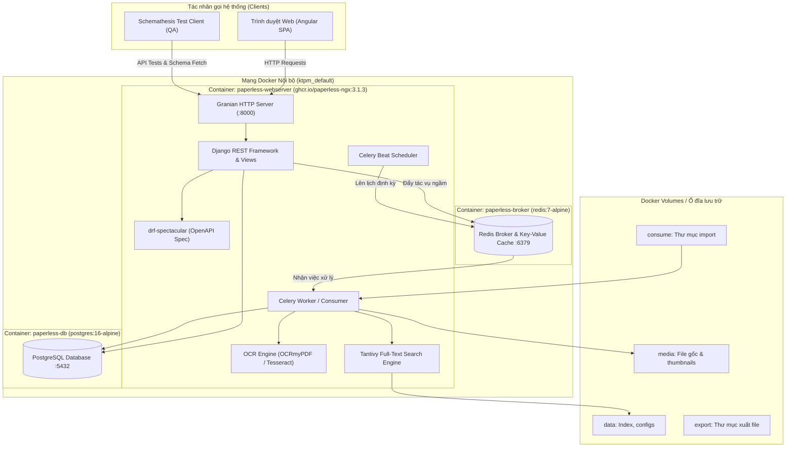
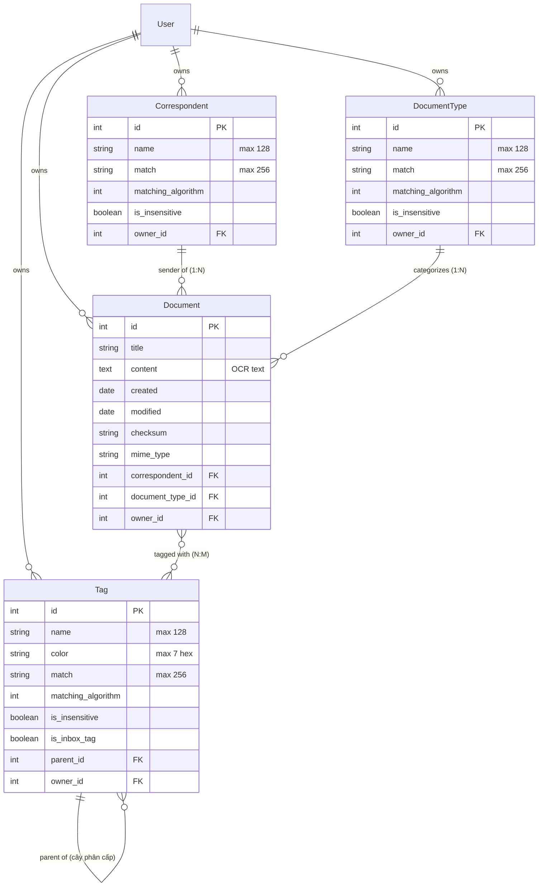
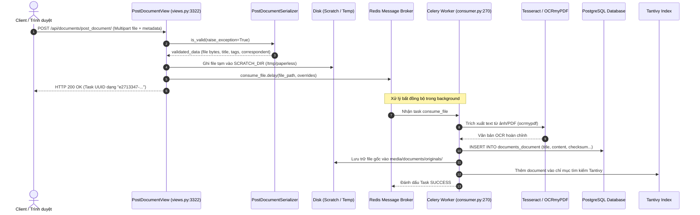
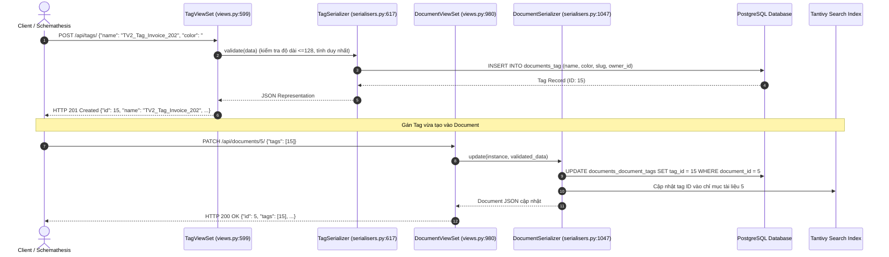
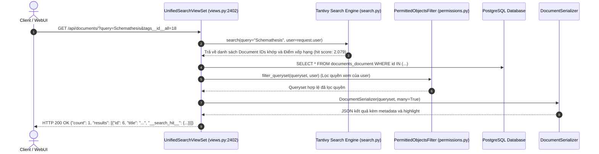
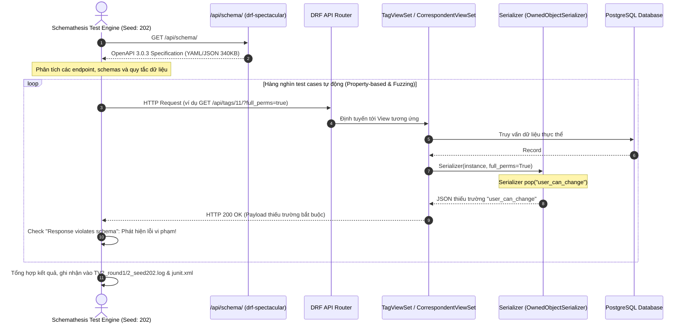

# TÀI LIỆU KIẾN TRÚC VÀ DATA FLOW HỆ THỐNG PAPERLESS-NGX
**Đề tài:** Kiểm thử hệ thống Paperless-ngx bằng kỹ thuật Schema-based API testing (Schemathesis)  
**Môn học:** Kiểm thử phần mềm — Trường Đại học Đà Lạt  
**Thành viên thực hiện:** TV2 — Tạ Nhật Nguyên (Seed: 202)  
**Phiên bản hệ thống kiểm thử (Release Tag):** `v3.1.3` (Commit SHA: `d48663e9ebaadc4b413a6ca3bc88cb5fbc4e468e`)  
**Ngày cập nhật:** 12/10/2026  

---

## MỤC LỤC
1. [B1. Mục tiêu hệ thống, Actor và Use Case](#b1-mục-tiêu-hệ-thống-actor-và-use-case)
2. [B2. Cấu trúc mã nguồn hệ thống](#b2-cấu-trúc-mã-nguồn-hệ-thống)
3. [B3. Các Module cốt lõi liên quan trực tiếp tới kiểm thử API (K05 / Schemathesis)](#b3-các-module-cốt-lõi-liên-quan-trực-tiếp-tới-kiểm-thử-api-k05--schemathesis)
4. [B4. Bảng ánh xạ Endpoint sang Mã nguồn & Ràng buộc Validation](#b4-bảng-ánh-xạ-endpoint-sang-mã-nguồn--ràng-buộc-validation)

---

## B1. Mục tiêu hệ thống, Actor và Use Case

### 1. Mục tiêu hệ thống (System Overview)
*Nguồn tham khảo: [paperless-ngx/README.md](file:///c:/Users/storm/Downloads/KiemThuPhanMem/KTPM/paperless-ngx/README.md#L18-L24)*

**Paperless-ngx** là hệ thống quản lý tài liệu mã nguồn mở (Document Management System - DMS) được phát triển nhằm mục tiêu chuyển đổi toàn bộ tài liệu vật lý/giấy tờ quét quang học của người dùng thành kho lưu trữ điện tử có khả năng tìm kiếm toàn văn trực tuyến (*"transforms your physical documents into a searchable online archive"*). Hệ thống tự động hóa chu trình: tiếp nhận tài liệu (quét/tải lên/email), nhận dạng ký tự quang học (OCR), lập chỉ mục tìm kiếm thông minh, gắn nhãn metadata, và phân quyền quản lý theo tiêu chuẩn doanh nghiệp.

### 2. Danh sách Actor (Tác nhân)

| Actor | Phân loại | Mô tả vai trò trong hệ thống |
| :--- | :--- | :--- |
| **End User** (Người dùng thông thường) | Human Actor | Tương tác qua giao diện web Angular (`src-ui/`), xem/tìm kiếm tài liệu, tải tài liệu cá nhân lên, chỉnh sửa tag/loại tài liệu thuộc quyền sở hữu của mình. |
| **Administrator** (Quản trị viên) | Human Actor | Có quyền Superuser, quản trị người dùng, phân quyền nhóm (Django Guardian), cấu hình hệ thống (`/api/config/`), quản lý logs và quy tắc workflow. |
| **Background Consumer / Worker** | System Actor | Tác vụ nền bất đồng bộ (Celery Worker & Celery Beat), giám sát hàng đợi Redis, tiếp nhận file từ thư mục `consume/`, chạy OCR và trích xuất nội dung văn bản. |
| **External Systems** | External Actor | Máy chủ Email (IMAP Server qua `paperless_mail`), công cụ trích xuất PDF bên ngoài (Gotenberg, Apache Tika), hệ thống OCR (Tesseract). |
| **QA / Schemathesis Client** | Testing Actor | Client tự động đóng vai trò người kiểm thử, gửi hàng nghìn request HTTP theo đặc tả OpenAPI Schema để rà soát lỗi crash, lỗi lệch schema và lỗi mã phản hồi. |

### 3. Use Case chính của hệ thống (5 - 8 use case cốt lõi)
1. **Tải lên tài liệu (Document Ingestion):** Người dùng hoặc hệ thống đẩy tệp tin (PDF, ảnh, văn bản) vào hệ thống qua API endpoint `/api/documents/post_document/` hoặc thư mục theo dõi `consume/`.
2. **Nhận dạng và trích xuất OCR (OCR Processing):** Hệ thống nền gọi engine `ocrmypdf` / `Tesseract` để chuyển đổi hình ảnh tài liệu thành văn bản thô phục vụ tìm kiếm.
3. **Quản lý phân loại & Metadata (Metadata Tagging):** Tạo mới, chỉnh sửa, xóa và gán nhãn Thẻ (Tag), Người gửi/đối tác (Correspondent), Loại tài liệu (Document Type) và Trường tùy biến (Custom Fields).
4. **Tìm kiếm và lọc nâng cao (Search & Filtering):** Tìm kiếm toàn văn qua Tantivy/Whoosh engine và lọc đa tiêu chí theo ngày tạo, tag, correspondent qua `/api/documents/`.
5. **Quản trị người dùng & Phân quyền đối tượng (Auth & Object Permissions):** Cấp quyền chi tiết (View/Change) trên từng tài liệu và metadata thông qua Django-Guardian.
6. **Tự động hóa luồng tài liệu (Workflow Automation):** Định nghĩa trigger và action tự động gán tag, di chuyển thư mục lưu trữ dựa trên thuật toán so khớp (matching algorithms).
7. **Xác thực API & Khai thác OpenAPI Schema:** Client xác thực qua Token (`/api/token/`) và trích xuất đặc tả REST API (`/api/schema/`).

### 4. Bảng phụ thuộc chính và phiên bản (Dependencies & Versions)
*Nguồn tham khảo: [paperless-ngx/pyproject.toml](file:///c:/Users/storm/Downloads/KiemThuPhanMem/KTPM/paperless-ngx/pyproject.toml) và [paperless-ngx/src-ui/package.json](file:///c:/Users/storm/Downloads/KiemThuPhanMem/KTPM/paperless-ngx/src-ui/package.json) tại tag `v3.1.3`*

| Thành phần | Công nghệ / Thư viện | Phiên bản ghim trong repo | Vai trò kỹ thuật |
| :--- | :--- | :--- | :--- |
| **Backend Core** | Python / Django | Python `>=3.11`, Django `~=5.2.13` | Framework backend MVC & ORM chính |
| **REST API** | Django REST Framework | `djangorestframework~=3.16` | Xây dựng API endpoints, serializers, viewsets |
| **OpenAPI Generator** | drf-spectacular | `drf-spectacular~=0.30` | Sinh schema OpenAPI 3.0.3 tự động từ mã DRF |
| **HTTP Server** | Granian (Rust-based) | `granian[uvloop]~=2.7.0` | ASGI/WSGI web server hiệu năng cao |
| **Task Queue** | Celery | `celery[redis]~=5.6.2` | Quản lý tác vụ nền và worker bất đồng bộ |
| **Message Broker** | Redis / Valkey | `redis[hiredis]~=5.2.1` (Image: `redis:7-alpine`) | Broker lưu trữ message queue và bộ nhớ đệm cache |
| **Database** | PostgreSQL | `psycopg[c,pool]==3.3.4` (Image: `postgres:16-alpine`) | Cơ sở dữ liệu quan hệ lưu trữ thực thể |
| **OCR Engine** | OCRmyPDF / Tesseract | `ocrmypdf~=17.7.0` | Nhận dạng ký tự quang học cho file quét |
| **Search Engine** | Tantivy | `tantivy~=0.26.0` | Lập chỉ mục tìm kiếm toàn văn bản (full-text index) |
| **Frontend Framework** | Angular | `@angular/core: ~22.1.3` | Giao diện người dùng Single Page Application |
| **Frontend UI Lib** | Bootstrap / ng-bootstrap | `bootstrap: ^5.3.8`, `@ng-bootstrap/ng-bootstrap: ^21.0.0` | Thiết kế giao diện responsive hiện đại |

---

## B2. Cấu trúc mã nguồn hệ thống

### 1. Khảo sát thư mục thực tế bằng lệnh `ls`
Đã chạy xác minh bằng lệnh thực tế tại thư mục gốc [paperless-ngx/](file:///c:/Users/storm/Downloads/KiemThuPhanMem/KTPM/paperless-ngx):

- **Thư mục cấp 1:**
  - `docker/`: Chứa cấu hình Docker Compose mẫu (`docker/compose/`) và script khởi tạo container (`docker/rootfs/`).
  - `docs/`: Tài liệu kỹ thuật, kiến trúc và hướng dẫn cài đặt của dự án Paperless-ngx.
  - `scripts/`: Chứa các kịch bản tiện ích quản trị, cài đặt và kiểm tra hệ thống.
  - `src/`: Toàn bộ mã nguồn Backend Python / Django.
  - `src-ui/`: Toàn bộ mã nguồn Frontend Angular.
  - `.github/`: Chứa cấu hình CI/CD GitHub Actions workflows.
- **Thư mục cấp 2 trong `src/`:**
  - `src/documents/`: Ứng dụng chính của Django (chứa models, views, serializers, tasks, filters).
  - `src/paperless/`: Cấu hình toàn cục Django project (`settings.py`, `urls.py`, `auth.py`).
  - `src/paperless_ai/`: Module phụ trợ xử lý embeddings và LLM.
  - `src/paperless_mail/`: Module nạp và bóc tách tài liệu từ hộp thư điện tử.
  - `src/locale/`: Thư mục chứa các tệp tin dịch thuật đa ngôn ngữ (gettext `.po`/`.mo`).
- **Thư mục cấp 2 trong `src-ui/`:**
  - `src-ui/src/`: Mã nguồn TypeScript, components, services của ứng dụng Angular.
  - `src-ui/e2e/`: Bộ kịch bản kiểm thử tích hợp đầu cuối (Playwright E2E tests).

### 2. Cây thư mục rút gọn (Directory Tree)

```text
paperless-ngx/ (Tag v3.1.3)
├── docker/
│   ├── compose/                # File Docker Compose mẫu (Postgres, MariaDB, SQLite)
│   └── rootfs/                 # Script init container (s6-overlay services)
├── docs/                       # Tài liệu hướng dẫn sử dụng và cấu hình
├── src/                        # === BACKEND DJANGO ===
│   ├── documents/              # App cốt lõi: xử lý tài liệu, metadata, OCR, workflow
│   │   ├── models.py           # Định nghĩa cấu trúc dữ liệu: Document, Tag, Correspondent...
│   │   ├── views.py            # Khai báo ViewSets và API handlers
│   │   ├── serialisers.py      # Bóc tách, validate dữ liệu và ánh xạ schema
│   │   ├── filters.py          # Bộ lọc đa tiêu chí cho API (Django-Filter)
│   │   ├── consumer.py         # Pipeline nạp và tiền xử lý tài liệu
│   │   ├── tasks.py            # Định nghĩa Celery tasks bất đồng bộ
│   │   └── tests/              # Bộ test kiểm thử đơn vị backend sẵn có
│   ├── paperless/              # Cấu hình dự án Django
│   │   ├── settings.py         # Thiết lập biến môi trường, database, cache, apps
│   │   ├── urls.py             # Định tuyến URL gốc và đăng ký DRF API Router
│   │   └── views.py            # Các view xác thực và thông tin hệ thống
│   ├── paperless_ai/           # Module trích xuất và tìm kiếm bằng AI/LLM
│   ├── paperless_mail/         # Module tích hợp đọc email qua IMAP
│   └── manage.py               # Django CLI management script
├── src-ui/                     # === FRONTEND ANGULAR ===
│   ├── src/                    # Mã nguồn Angular (components, services, HTML/CSS)
│   ├── e2e/                    # Bộ test tự động hóa E2E bằng Playwright
│   └── package.json            # Khai báo thư viện và script Frontend
├── pyproject.toml              # Khai báo dependency backend Python
└── README.md                   # Tài liệu giới thiệu dự án
```

### 3. Phân vùng trách nhiệm mã nguồn
- **Backend Django:** Nằm trong thư mục [paperless-ngx/src/](file:///c:/Users/storm/Downloads/KiemThuPhanMem/KTPM/paperless-ngx/src).
- **Frontend Angular:** Nằm trong thư mục [paperless-ngx/src-ui/](file:///c:/Users/storm/Downloads/KiemThuPhanMem/KTPM/paperless-ngx/src-ui).
- **Cấu hình Docker:** Nằm trong thư mục [paperless-ngx/docker/compose/](file:///c:/Users/storm/Downloads/KiemThuPhanMem/KTPM/paperless-ngx/docker/compose).
- **Tài liệu hệ thống:** Nằm trong thư mục [paperless-ngx/docs/](file:///c:/Users/storm/Downloads/KiemThuPhanMem/KTPM/paperless-ngx/docs).
- **Kiểm thử sẵn có:** Unit tests tại [src/documents/tests/](file:///c:/Users/storm/Downloads/KiemThuPhanMem/KTPM/paperless-ngx/src/documents/tests) và E2E tests tại [src-ui/e2e/](file:///c:/Users/storm/Downloads/KiemThuPhanMem/KTPM/paperless-ngx/src-ui/e2e).

---

## B3. Các Module cốt lõi liên quan trực tiếp tới kiểm thử API (K05 / Schemathesis)

Đã chọn và khảo sát trực tiếp 4 module backend trọng yếu:

### 1. Module Views & Controllers: `src/documents/views.py`
- **Đường dẫn file:** [paperless-ngx/src/documents/views.py](file:///c:/Users/storm/Downloads/KiemThuPhanMem/KTPM/paperless-ngx/src/documents/views.py) (Dung lượng: ~209 KB, 5.510 dòng).
- **Vai trò:** Định nghĩa các lớp `ViewSet` và `APIView` tiếp nhận HTTP request từ client, kiểm tra quyền truy cập (Permission Classes), gọi Serializer xử lý và trả về HTTP response với status code tương ứng.
- **Vì sao liên quan tới Schemathesis:** 
  - View quyết định status code trả về (`200`, `201`, `204`, `400`, `403`, `404`).
  - ViewSet liên kết với `@extend_schema_view` của `drf-spectacular` để định nghĩa metadata xuất hiện trong OpenAPI Schema.
- **Rủi ro tiềm ẩn nhìn thấy từ mã:** 
  - Việc ghi đè các hàm `get_serializer()`, `get_serializer_context()`, `retrieve()`, `list()` với nhiều logic phân quyền động có thể khiến dữ liệu phản hồi bị lệch so với schema tĩnh đã khai báo trước.

### 2. Module Serializers & Data Binding: `src/documents/serialisers.py`
- **Đường dẫn file:** [paperless-ngx/src/documents/serialisers.py](file:///c:/Users/storm/Downloads/KiemThuPhanMem/KTPM/paperless-ngx/src/documents/serialisers.py) (Dung lượng: ~137 KB, 3.654 dòng).
- **Vai trò:** Chuyển đổi hai chiều giữa Model ORM và JSON Payload. Chịu trách nhiệm validate tính hợp lệ của kiểu dữ liệu đầu vào và định hình cấu trúc dữ liệu đầu ra.
- **Vì sao liên quan tới Schemathesis:**
  - `drf-spectacular` duyệt trực tiếp các lớp Serializer để tự động sinh ra cấu trúc các components (`/components/schemas/Tag`, `/components/schemas/Correspondent`, v.v.).
  - Mọi ràng buộc `required`, `readOnly`, `maxLength`, `type` đều xuất phát từ đây.
- **Rủi ro tiềm ẩn (Đã phát hiện lỗi thực tế ở Vòng 1 và Vòng 2):** 
  - Trong lớp `OwnedObjectSerializer` ([dòng 314-319](file:///c:/Users/storm/Downloads/KiemThuPhanMem/KTPM/paperless-ngx/src/documents/serialisers.py#L314-L319)), khi có tham số `full_perms=True`, mã nguồn chủ động loại bỏ trường `user_can_change`:
    ```python
    if self.full_perms:
        self.fields.pop("user_can_change")
    ```
    Trong khi đó, OpenAPI schema lại định nghĩa `user_can_change` là trường bắt buộc (`required`), dẫn đến lỗi lệch Schema 100% khi Schemathesis gửi query `full_perms=true`.

### 3. Module Database Models & Data Constraints: `src/documents/models.py`
- **Đường dẫn file:** [paperless-ngx/src/documents/models.py](file:///c:/Users/storm/Downloads/KiemThuPhanMem/KTPM/paperless-ngx/src/documents/models.py) (Dung lượng: ~60 KB, 2.026 dòng).
- **Vai trò:** Định nghĩa thực thể dữ liệu trong cơ sở dữ liệu PostgreSQL, các khóa ngoại (Foreign Keys), ràng buộc toàn vẹn dữ liệu (UniqueConstraint) và trường so khớp matching.
- **Vì sao liên quan tới Schemathesis:**
  - DRF tự động suy luận validation từ thuộc tính trường trong Model (ví dụ: `max_length=128`, `blank=False`, `unique=True`).
- **Rủi ro tiềm ẩn:** 
  - Model bắt buộc tính duy nhất của tên (`name` + `owner`) ở tầng cơ sở dữ liệu ([dòng 80-90](file:///c:/Users/storm/Downloads/KiemThuPhanMem/KTPM/paperless-ngx/src/documents/models.py#L80-L90)). Nếu tầng serializer không bắt lỗi trước một cách chặt chẽ, database exception có thể văng ra gây lỗi `500 Internal Server Error`.

### 4. Module Filters & Query Parameters: `src/documents/filters.py`
- **Đường dẫn file:** [paperless-ngx/src/documents/filters.py](file:///c:/Users/storm/Downloads/KiemThuPhanMem/KTPM/paperless-ngx/src/documents/filters.py) (Dung lượng: ~45 KB).
- **Vai trò:** Cung cấp bộ lọc query params cho các API danh sách (ví dụ: `name__icontains`, `created__date__gte`, `tags__id__all`).
- **Vì sao liên quan tới Schemathesis:**
  - Schemathesis sẽ sinh ngẫu nhiên hàng loạt tham số truy vấn dựa trên các FilterSet khai báo trong schema.
- **Rủi ro tiềm ẩn (Đã phát hiện lỗi ở Vòng 1):** 
  - Lỗi tràn số nguyên / float trong truy vấn ngày tháng (ví dụ: `modified__year=-1.17e-38`) không được validate chặn ở Filter, truyền thẳng xuống hàm `datetime.datetime` gây crash `OverflowError` (mã 500).

---

## B4. Bảng ánh xạ Endpoint sang Mã nguồn & Ràng buộc Validation

### 1. Bảng ánh xạ chi tiết 4 nhóm Endpoint kiểm thử
*Được trích xuất từ file [paperless-ngx/src/paperless/urls.py](file:///c:/Users/storm/Downloads/KiemThuPhanMem/KTPM/paperless-ngx/src/paperless/urls.py) (đăng ký router tại dòng 72-76) và [paperless-ngx/src/documents/views.py](file:///c:/Users/storm/Downloads/KiemThuPhanMem/KTPM/paperless-ngx/src/documents/views.py)*

| Endpoint URL | ViewSet / View | Serializer | Model | FilterSet | Phân quyền (Permissions) | File mã nguồn & Dòng |
| :--- | :--- | :--- | :--- | :--- | :--- | :--- |
| **`/api/tags/`** | `TagViewSet` | `TagSerializer` | `Tag` | `TagFilterSet` | `IsAuthenticated`, `PaperlessObjectPermissions` | [views.py:599](file:///c:/Users/storm/Downloads/KiemThuPhanMem/KTPM/paperless-ngx/src/documents/views.py#L599), [urls.py:76](file:///c:/Users/storm/Downloads/KiemThuPhanMem/KTPM/paperless-ngx/src/paperless/urls.py#L76) |
| **`/api/correspondents/`** | `CorrespondentViewSet` | `CorrespondentSerializer` | `Correspondent` | `CorrespondentFilterSet` | `IsAuthenticated`, `PaperlessObjectPermissions` | [views.py:553](file:///c:/Users/storm/Downloads/KiemThuPhanMem/KTPM/paperless-ngx/src/documents/views.py#L553), [urls.py:72](file:///c:/Users/storm/Downloads/KiemThuPhanMem/KTPM/paperless-ngx/src/paperless/urls.py#L72) |
| **`/api/document_types/`** | `DocumentTypeViewSet` | `DocumentTypeSerializer` | `DocumentType` | `DocumentTypeFilterSet` | `IsAuthenticated`, `PaperlessObjectPermissions` | [views.py:680](file:///c:/Users/storm/Downloads/KiemThuPhanMem/KTPM/paperless-ngx/src/documents/views.py#L680), [urls.py:73](file:///c:/Users/storm/Downloads/KiemThuPhanMem/KTPM/paperless-ngx/src/paperless/urls.py#L73) |
| **`/api/documents/`** | `UnifiedSearchViewSet` (kế thừa `DocumentViewSet`) | `DocumentSerializer` | `Document` | `DocumentFilterSet` | `IsAuthenticated`, `PaperlessObjectPermissions` | [views.py:980, 2402](file:///c:/Users/storm/Downloads/KiemThuPhanMem/KTPM/paperless-ngx/src/documents/views.py#L980), [urls.py:74](file:///c:/Users/storm/Downloads/KiemThuPhanMem/KTPM/paperless-ngx/src/paperless/urls.py#L74) |
| **`/api/documents/post_document/`** | `PostDocumentView` | `PostDocumentSerializer` | `Document` | *(Không có - Multipart)* | `IsAuthenticated`, `documents.add_document` | [views.py:3322](file:///c:/Users/storm/Downloads/KiemThuPhanMem/KTPM/paperless-ngx/src/documents/views.py#L3322), [urls.py:148](file:///c:/Users/storm/Downloads/KiemThuPhanMem/KTPM/paperless-ngx/src/paperless/urls.py#L148) |

---

### 2. Các ràng buộc Validate cụ thể của trường `name` và Metadata
*Đọc trực tiếp từ định nghĩa trong `MatchingModel` tại [src/documents/models.py:46-90](file:///c:/Users/storm/Downloads/KiemThuPhanMem/KTPM/paperless-ngx/src/documents/models.py#L46-L90)*

Thông tin này được sử dụng trực tiếp để thiết kế các test case kiểm thử giá trị biên (Boundary Value Analysis):

1. **Độ dài chuỗi (`max_length`):**
   - Trường `name` của `Tag`, `Correspondent`, `DocumentType`: Tối đa **128 ký tự** (`models.CharField(max_length=128)`).
   - Trường `match` (chuỗi quy tắc matching): Tối đa **256 ký tự** (`max_length=256`).
   - Trường `color` của `Tag`: Đúng định dạng HEX mã màu, tối đa **7 ký tự** (ví dụ `#ffffff`, mặc định `#a6cee3`).
2. **Tính bắt buộc & Rỗng:**
   - Trường `name` là **bắt buộc** (`blank=False`). Nếu gửi thiếu trường này, API trả về `400 Bad Request` kèm message `{"name": ["This field is required."]}`.
3. **Tính duy nhất (Uniqueness Constraints):**
   - Ràng buộc tổ hợp: `name` phải là duy nhất đối với cùng một người sở hữu `owner` (`UniqueConstraint(fields=["name", "owner"])`).
   - Đối với đối tượng không có owner (`owner__isnull=True`): `name` phải duy nhất trên toàn hệ thống.
4. **Ký tự đặc biệt & Null bytes:**
   - Trường `name` chấp nhận chuỗi UTF-8 đa ngôn ngữ, nhưng hệ thống từ chối ký tự Null byte (`\x00`) với mã `400 Bad Request`: `{"name": ["Null characters are not allowed."]}`.
5. **Ràng buộc cấu trúc cây phân cấp (Tag Nesting):**
   - Riêng `Tag` kế thừa `TreeNodeModel`: Giới hạn độ sâu phân cấp tối đa `MAX_NESTING_DEPTH = 5`.

---

## B5. Sơ đồ kiến trúc hệ thống (System Architecture Diagrams)

### 1. Sơ đồ Container & Component Architecture
Sơ đồ dưới đây mô tả kiến trúc triển khai thực tế của Paperless-ngx với 3 container Docker và các thành phần cốt lõi bên trong:



**Giải thích chi tiết sơ đồ container (3–5 câu):**
1. Hệ thống chạy trên 3 container Docker độc lập kết nối qua mạng nội bộ `ktpm_default`: `paperless-webserver`, `paperless-db` và `paperless-broker`.
2. Container `paperless-webserver` sử dụng tiến trình supervisor `s6-overlay` để điều phối đồng thời cả Web Server Granian (tiếp nhận HTTP request từ Angular và Schemathesis) lẫn các background worker (Celery Worker, Celery Beat).
3. Khi tài liệu được tải lên, Web Server không xử lý nặng ngay mà chỉ ghi nhận file tạm và đẩy một tác vụ bất đồng bộ vào `paperless-broker` (Redis), giúp API phản hồi tức thì với mã 200/202.
4. `Celery Worker` kéo tác vụ từ Redis để thực hiện OCR qua Tesseract, lưu bản ghi vào `paperless-db` (PostgreSQL), lưu file nhị phân vào volume `media/` và cập nhật chỉ mục tìm kiếm Tantivy vào volume `data/`.

---

### 2. Sơ đồ quan hệ dữ liệu rút gọn (ER Diagram)
Sơ đồ thể hiện mối quan hệ giữa các thực thể cốt lõi trong kiểm thử API, đọc trực tiếp từ [src/documents/models.py](file:///c:/Users/storm/Downloads/KiemThuPhanMem/KTPM/paperless-ngx/src/documents/models.py):



**Giải thích chi tiết quan hệ dữ liệu (3–5 câu):**
1. `Document` là thực thể trung tâm, đại diện cho tệp tài liệu lưu trữ, liên kết với một `Correspondent` (người gửi/cơ quan ban hành) và một `DocumentType` (loại văn bản như hóa đơn, hợp đồng) theo quan hệ 1-Nhiều (cho phép null).
2. Quan hệ giữa `Document` và `Tag` là quan hệ Nhiều-Nhiều (N:M) thông qua bảng trung gian `documents_document_tags`, cho phép một tài liệu gắn nhiều nhãn phân loại.
3. `Tag` có quan hệ đệ quy (self-referencing) thông qua trường `parent_id` (kế thừa `TreeNodeModel`), cho phép xây dựng cây nhãn lồng nhau tối đa 5 cấp.
4. Cả 3 thực thể metadata (`Tag`, `Correspondent`, `DocumentType`) đều kế thừa từ lớp trừu tượng `MatchingModel`, chia sẻ chung các trường quy tắc tự động gán nhãn (`match`, `matching_algorithm`, `is_insensitive`).

---

## B6. Sơ đồ luồng dữ liệu (Data Flow Sequence Diagrams)

Dưới đây là 4 sơ đồ tuần tự chi tiết biểu diễn luồng dữ liệu của 4 nghiệp vụ trọng yếu trong hệ thống:

### 1. Luồng 1: Upload và xử lý tài liệu bất đồng bộ (POST /api/documents/post_document/)
*Khớp với kịch bản A1 đã chạy thật (tạo Task UUID và tài liệu ID 1, 2).*



**Mô tả kỹ thuật:**
- Bước 1-5: `PostDocumentView` tiếp nhận request multipart, kiểm tra quyền `documents.add_document`, ghi file tạm vào thư mục scratch và phát lệnh `consume_file.delay()` vào Redis.
- Bước 6: API trả về Task UUID ngay lập tức để client không bị nghẽn thời gian chờ.
- Bước 7-12: `Consumer` trong `src/documents/consumer.py` gọi engine OCR nhận dạng chữ, lưu metadata và văn bản trích xuất vào PostgreSQL, di chuyển file vật lý vào thư mục lưu trữ vĩnh viễn và cập nhật chỉ mục tìm kiếm.

---

### 2. Luồng 2: Tạo Metadata & Gán nhãn tài liệu (POST /api/tags/ và PATCH /api/documents/{id}/)
*Khớp với các thao tác đã kiểm thử ở A1 và Vòng 2 (A3).*



**Mô tả kỹ thuật:**
- Quá trình tạo Tag được xử lý bởi `TagViewSet` và `TagSerializer`: validate độ dài tên không vượt quá 128 ký tự và kiểm tra `UniqueConstraint` (name, owner).
- Khi client cập nhật trường `tags` của Document bằng phương thức PATCH, `DocumentSerializer` quản lý quan hệ ManyToMany, cập nhật bảng liên kết trong database và đồng bộ hóa lại chỉ mục tìm kiếm.

---

### 3. Luồng 3: Tìm kiếm toàn văn và lọc tài liệu (GET /api/documents/?query=...)
*Khớp với nghiệp vụ tìm kiếm query="Schemathesis" đã kiểm thử ở A1.*



**Mô tả kỹ thuật:**
- `UnifiedSearchViewSet` tiếp nhận tham số query toàn văn và chuyển cho engine Tantivy để tra cứu theo chỉ mục ngược (inverted index) cực nhanh.
- Sau khi có danh sách ID phù hợp, `PermittedObjectsFilter` kiểm tra quyền sở hữu và quyền được chia sẻ của người dùng qua Django-Guardian trước khi nạp dữ liệu từ PostgreSQL.
- Kết quả trả về được gắn kèm trường đặc biệt `__search_hit__` chứa điểm số xếp hạng và phần bôi đậm từ khóa (highlights).

---

### 4. Luồng 4: Quy trình Schemathesis kiểm thử Schema-based (K05 Focus)
*Mô tả trực tiếp cách Schemathesis phát hiện các lỗi vi phạm schema trong Vòng 1 và Vòng 2.*



**Mô tả kỹ thuật:**
- Luồng này gắn liền trực tiếp với đề tài K05: minh họa cách Schemathesis nạp schema OpenAPI làm chuẩn mẫu, sinh dữ liệu ngẫu nhiên dựa trên seed `202`, gửi request và đối chiếu phản hồi thực tế từ hệ thống Paperless-ngx để phát hiện các lỗi bất thường.

