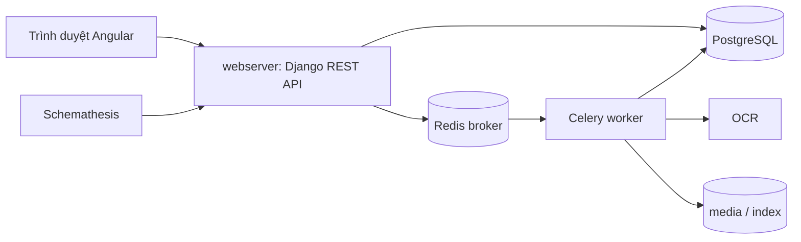

# TODO_TV2.md — Việc của TV2 (Kiến trúc & Data flow)

> **Cách dùng:** đặt file này vào `docs/TODO_TV2.md`, cạnh `docs/AGENT_TASKS.md`. Nhắn agent:
> *"Đọc docs/AGENT_TASKS.md rồi docs/TODO_TV2.md. Làm theo TODO_TV2 từng bước, dừng hỏi tôi ở mọi chỗ [DỪNG]."*

**Người thực hiện:** TV2 — seed ngẫu nhiên **202**.
**Đề tài:** R08 Paperless-ngx + K05 Schemathesis. Mốc giữa kỳ: **20/10**.
**Phụ trách theo đề của thầy:** Phần A (mục tiêu hệ thống, actor, module, luồng dữ liệu) và Phần B (sơ đồ kiến trúc, 3-5 module liên quan tới kiểm thử).

**Quy tắc:** mọi quy tắc cứng ở mục 0 của `AGENT_TASKS.md` đều áp dụng ở đây (chỉ test localhost, không bịa số liệu, không commit bí mật, ghim phiên bản). Ngoài ra, riêng phần kiến trúc:
- Chỉ **đọc** mã nguồn trong `paperless-ngx/`, không sửa.
- Chỗ nào **đọc trực tiếp từ mã** thì ghi kèm đường dẫn file; chỗ nào **suy luận** thì ghi rõ chữ "[suy luận]" để cả nhóm kiểm lại.
- Cấu trúc thư mục thay đổi theo tag. Luôn chạy `ls` để xác nhận trước khi khẳng định một đường dẫn tồn tại.

---

## Lịch (tính từ hôm nay 12/10)

| Hạn | Việc |
|---|---|
| 12/10 | A1 (dựng hệ thống) + A2 (vòng 1) xong |
| 13/10 | B1, B2 xong (cấu trúc repo, module) |
| 14/10 | B3, B4 xong bản nháp; A3 (vòng 2) xong |
| 15/10 | B5, B6 xong; quay video 3 luồng |
| 16/10 | A4 (vòng 3) + C (liên kết lỗi với mã nguồn) |
| 17/10 | Soát lại, sửa sơ đồ theo góp ý của nhóm |
| 18/10 | D (chuẩn bị trình bày) |
| 19/10 | Tập demo cả nhóm |
| 20/10 | Báo cáo giữa kỳ |

---

## PHẦN A — Việc chung của cả nhóm (làm trên máy TV2)

Làm theo `AGENT_TASKS.md`, **với seed 202**, tên file kết quả bắt đầu bằng `TV2_`.

- [x] **A1.** Mục 2-7 của `AGENT_TASKS.md`: pre-flight, clone repo và ghim đúng tag nhóm đã chốt, dựng Docker, kiểm tra schema, seed, kiểm 3 luồng nghiệp vụ, kiểm script reset.
- [x] **A2.** Chạy **vòng 1** (chỉ GET), lưu `results/TV2_round1_seed202.*`.
- [x] **A3.** Chạy **vòng 2** (ghi dữ liệu trên tags/correspondents/document_types), reset trước khi chạy, lưu `results/TV2_round2_seed202.*`.
- [x] **A4.** Chạy **vòng 3** (thêm `/api/documents/`, bật toàn bộ checks), reset trước, lưu `results/TV2_round3_seed202.*`.
- [x] **A5.** Tái hiện và ghi lỗi theo mục 10 của `AGENT_TASKS.md` (`docs/bugs/BUG-xx.md`).
- [x] **A6.** Mục 9: viết test case thiết kế tay cho **một** tài nguyên theo phân công của nhóm (hỏi người dùng TV2 phụ trách `tags`, `correspondents` hay `document_types`; các tài nguyên còn lại do thành viên khác làm), vào `docs/TEST_CASES.md`.
- [ ] **A7.** Người dùng **tự chụp** ảnh bằng chứng (đăng nhập, danh sách tài liệu, Swagger, 3 luồng) và quay video ngắn cho 3 luồng. Agent chỉ nhắc, không làm thay.

---

## PHẦN B — Việc riêng của TV2: kiến trúc và data flow

Tất cả ghi vào `docs/ARCHITECTURE_NOTES.md` (một file, chia mục rõ ràng). Sơ đồ viết bằng **Mermaid**.

### B1. Mục tiêu hệ thống, actor, use case (Phần A của thầy)

- [x] Viết 1 đoạn ngắn: Paperless-ngx là gì, giải quyết vấn đề nào (đọc từ trang giới thiệu/README của repo, **dẫn nguồn**).
- [x] Liệt kê **actor**: người dùng thường, quản trị viên, tác vụ nền (consumer/worker), hệ thống ngoài (email, thư mục theo dõi nếu có), và **QA/Schemathesis** (client gọi API).
- [x] Liệt kê **use case chính** (5-8 dòng): tải tài liệu lên, tìm kiếm, gắn tag/correspondent/loại tài liệu, quản lý người dùng và quyền, lấy token API...
- [x] Ghi các phụ thuộc chính (Python/Django, Celery, Redis, PostgreSQL, OCR engine, Angular...). Đọc từ file khai báo thật (ví dụ `pyproject.toml`, `package.json` trong `src-ui/`, file compose). Ghi phiên bản **đúng như file ở tag đã ghim**.

### B2. Cấu trúc mã nguồn

- [x] Chạy `ls` ở thư mục gốc repo và `ls src` (nếu có), `ls src-ui`, `ls docker`. Mô tả **một dòng mỗi thư mục cấp 1, 2**.
- [x] Làm cây thư mục rút gọn (khối code) trong tài liệu.
- [x] Ghi rõ thư mục nào chứa: backend Django, frontend Angular, cấu hình Docker, tài liệu, test sẵn có của dự án.

### B3. Chọn 3-5 module liên quan trực tiếp tới kiểm thử

Gợi ý các ứng viên (**phải kiểm tra bằng `ls` xem có thật không ở tag này**):
`src/documents/` (model, serializer, view, filter của API), `src/paperless/` (cấu hình, URL gốc, xác thực), phần consumer/tasks xử lý bất đồng bộ (`consumer.py`, `tasks.py` trong `src/documents/`), phần OCR (ví dụ `src/paperless_tesseract/`), phần tìm kiếm/index (ví dụ `index.py`), phần sinh OpenAPI schema.

Với **mỗi module chọn**, ghi:
- [x] Đường dẫn thư mục/file chính.
- [x] Vai trò (2-3 câu).
- [x] **Vì sao liên quan tới Schemathesis/K05** (ví dụ: serializer quyết định schema; view quyết định status code; filter quyết định tham số query).
- [x] Rủi ro tiềm ẩn nhìn thấy khi đọc mã (ví dụ nhiều ràng buộc validate, tham số lọc phức tạp). Đánh dấu "[suy luận]" nếu chưa chạy thử để xác nhận.

### B4. Bảng ánh xạ endpoint → mã nguồn (rất quan trọng cho phân tích lỗi sau này)

- [x] Với 4 nhóm endpoint trong phạm vi test (`/api/tags/`, `/api/correspondents/`, `/api/document_types/`, `/api/documents/`), tìm và ghi:

| Endpoint | ViewSet/View | Serializer | Model | Filter | Phân quyền | File + dòng |
|---|---|---|---|---|---|---|

- [x] Tìm bằng cách đọc file URL (đăng ký router) rồi lần theo từng ViewSet. Chỉ ghi điều đã đọc thấy trong mã.
- [x] Ghi **các ràng buộc validate** của trường `name` (độ dài tối đa, ký tự, tính duy nhất) dựa trên model/serializer. Thông tin này dùng để đối chiếu với test case giá trị biên ở `TEST_CASES.md`.

### B5. Sơ đồ kiến trúc (Phần B của thầy, **bắt buộc ít nhất 1**)

Vẽ bằng Mermaid, đặt trong `docs/ARCHITECTURE_NOTES.md`:

- [x] **Sơ đồ container/component:** Trình duyệt (Angular) và Client API (Schemathesis) → Web server (Django REST API) → Celery worker ↔ Redis (broker) → OCR → PostgreSQL + thư mục media + chỉ mục tìm kiếm. Tên container lấy **đúng** từ file `deploy/docker-compose.yml` thật.
- [x] **Sơ đồ quan hệ dữ liệu (ER) rút gọn:** Document, Tag, Correspondent, DocumentType và quan hệ giữa chúng, đọc từ `models.py`.
- [x] Mỗi sơ đồ kèm 3-5 câu giải thích bằng tiếng Việt dễ hiểu.

Gợi ý khung Mermaid (agent điều chỉnh theo thực tế đọc được, không chép nguyên):

### B6. Sơ đồ luồng dữ liệu (data flow) cho 3-5 nghiệp vụ

Mỗi nghiệp vụ: 1 sơ đồ tuần tự Mermaid (`sequenceDiagram`) + vài câu giải thích + **tham chiếu file mã nguồn** nơi xử lý từng bước.

- [x] **Luồng 1:** Upload tài liệu → nhận request → đưa vào hàng đợi → consume → OCR → lưu DB → cập nhật chỉ mục.
- [x] **Luồng 2:** Tạo tag/correspondent/loại tài liệu, gán vào tài liệu, và cơ chế gán tự động (matching) nếu có.
- [x] **Luồng 3:** Tìm kiếm và lọc tài liệu.
- [x] **Luồng 4 (tùy chọn):** Xác thực bằng token và kiểm tra quyền.
- [x] **Luồng 5 (tùy chọn):** Một request của Schemathesis đi qua hệ thống: schema → request → view → serializer → DB → response (gắn luôn với K05).
- [x] Ít nhất **3 luồng** phải khớp với 3 luồng đã chạy thật ở A1 (cùng tên, cùng endpoint).

---

## PHẦN C — Liên kết lỗi với mã nguồn (hỗ trợ TV5)

- [x] **C1.** Với mỗi `docs/bugs/BUG-xx.md` đã có (của TV2 và của người khác khi nhóm gộp vào repo), dùng bảng ở B4 để tìm view/serializer/model liên quan.
- [x] **C2.** Đọc đoạn mã liên quan, ghi vào mục "Nguyên nhân gốc" của file lỗi: file, hàm, dòng, và **giải thích vì sao input đó gây ra hành vi quan sát được**. Chỉ ghi điều đọc thấy; chưa chắc thì ghi "[suy luận]".
- [x] **C3.** Nếu không có lỗi nào: ghi vào `ARCHITECTURE_NOTES.md` mục "Ghi chú về ràng buộc" 5-8 hành vi đã quan sát là **đúng** (ví dụ tên trùng bị từ chối với 400), kèm dòng mã chịu trách nhiệm.

---

## PHẦN D — Chuẩn bị trình bày (Phần A, B của slide)

- [x] **D1.** Soạn **ghi chú trình bày** (không phải nguyên văn để đọc) cho khoảng 3-4 slide: mục tiêu và actor; kiến trúc tổng thể; 3-5 module; luồng dữ liệu. Mỗi slide: ý chính, hình sơ đồ nào dùng, 2-3 câu để nói.
- [x] **D2.** Xuất sơ đồ Mermaid thành hình (có thể dán vào mermaid.live rồi lưu PNG; agent chỉ hướng dẫn, người dùng tự xuất nếu agent không làm được), lưu vào `docs/img/`.
- [x] **D3.** Soạn **15 câu hỏi tự kiểm tra** thầy có thể hỏi về phần kiến trúc, kèm câu trả lời ngắn lấy từ chính tài liệu đã viết. Ví dụ: "Tài liệu được OCR ở container nào?", "Vì sao Redis cần thiết?", "Schemathesis đọc thông tin gì từ hệ thống?", "Endpoint `/api/tags/` do lớp nào xử lý?".

---

## Checklist hoàn thành của TV2

- [x] Chạy được hệ thống trên máy TV2, có 3 luồng nghiệp vụ (người dùng tự chụp/quay video bổ sung).
- [x] Có file kết quả vòng 1, 2, 3 trong `results/` với seed 202.
- [x] `ARCHITECTURE_NOTES.md` đủ B1-B6, mỗi khẳng định về mã nguồn có đường dẫn file.
- [x] Có ít nhất 1 sơ đồ container, 1 ER, và 3 sơ đồ tuần tự cho 3 luồng.
- [x] Bảng B4 điền đủ 4 nhóm endpoint.
- [x] Mỗi lỗi (nếu có) đã gắn nguyên nhân gốc với mã nguồn, hoặc có ghi chú hành vi đúng (C3).
- [x] Ghi chú trình bày và 15 câu hỏi tự kiểm tra xong.
- [x] Đã commit từng bước, không chứa token/mật khẩu/`.env`, commit dưới tên TV2.

**Khi xong,** báo người dùng bằng tiếng Việt: đã làm gì, điểm nào là "[suy luận]" cần kiểm lại, và những việc người dùng phải tự làm (chụp ảnh, quay video, học thuộc phần giải thích). Người dùng cần **tự hiểu và giải thích được** mọi sơ đồ vì thầy sẽ hỏi trực tiếp.
