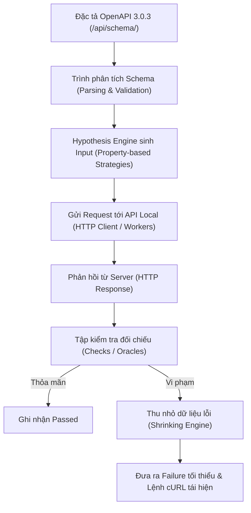

# KẾ HOẠCH KIỂM THỬ TỰ ĐỘNG SCHEMATHESIS — PHẦN D (TV3)

**Học phần:** Kiểm thử phần mềm — Đề tài: Paperless-ngx (R08) + Schemathesis (K05)  
**Tác giả:** Nguyễn Khiêm Thuận · MSSV: 2312764 · TV3 · Seed Schemathesis: 303  
**Ngày hoàn thành:** 16/10/2026 (Báo cáo chính thức)  
**Hệ thống mục tiêu:** REST API của Paperless-ngx v3.1.3 chạy Docker local (`http://localhost:8000`)  
**Commit cơ sở:** `62e9a2ffbcb36bec9672c0e0c7a504cab20bf3f8` (master)

---

## 1. Mục tiêu Kiểm thử
1. Đánh giá tính tuân thủ hợp đồng giao tiếp (API Contract Conformance) giữa mã nguồn thực tế của Paperless-ngx và tài liệu đặc tả OpenAPI 3.0.3 được sinh tự động tại `/api/schema/`.
2. Tự động phát hiện các lỗi ngoại lệ chưa được bắt (Unhandled Server Errors - HTTP 500) và các hành vi xử lý dữ liệu đầu vào không hợp lệ thiếu an toàn.
3. Xác minh độ bao phủ (Coverage) và tính toàn vẹn trạng thái (Stateful testing) của các chuỗi gọi API liên kết giữa các tài nguyên phân loại tài liệu.
4. Kết hợp kiểm thử tự động với kiểm thử thủ công có thiết kế để thẩm định các ràng buộc nghiệp vụ mà đặc tả OpenAPI chưa mô tả đầy đủ.

---

## 2. Nguyên lý Kỹ thuật (Schema-based & Property-based Testing)

### 2.1 Chu trình Thực thi của Schemathesis

1. **Đọc và phân tích OpenAPI Schema:** Schemathesis phân tích toàn bộ `paths`, `methods`, tham số `parameters`, `requestBody`, `responses` và các schema con trong `components.schemas` (kiểu dữ liệu `type`, trường bắt buộc `required`, độ dài tối đa `maxLength`, định dạng `format`).
2. **Sinh dữ liệu kiểm thử (Property-based Testing qua Hypothesis):** Thay vì sử dụng danh sách ca kiểm thử cố định, Schemathesis sử dụng thư viện Hypothesis để tự động sinh hàng trăm nghìn tổ hợp dữ liệu bao gồm: giá trị hợp lệ, giá trị biên, giá trị null, chuỗi rỗng, chuỗi Unicode/emoji, số âm cực lớn, và các cấu trúc lồng nhau vi phạm schema.
3. **Thực thi và đối chiếu (Checks làm Oracle):** Từng phản hồi được thẩm định qua tập các bộ kiểm tra chuẩn:
   - `not_a_server_error`: Đảm bảo API không bao giờ văng mã HTTP 5xx.
   - `status_code_conformance`: Mã trạng thái HTTP trả về phải nằm trong danh mục đã được tài liệu hóa trong schema.
   - `content_type_conformance`: Header `Content-Type` trả về phải khớp định dạng công bố (ví dụ `application/json`).
   - `response_headers_conformance`: Đầy đủ các header bắt buộc theo hợp đồng.
   - `response_schema_conformance`: Cấu trúc JSON body trả về phải thỏa mãn toàn bộ ràng buộc của schema phản hồi.
4. **Thu nhỏ dữ liệu lỗi (Shrinking):** Khi phát hiện vi phạm, Hypothesis tự động kích hoạt thuật toán thu nhỏ (shrinking) để loại bỏ các ký tự dư thừa, tìm ra payload ngắn nhất và tối thiểu nhất gây ra lỗi nhằm giúp lập trình viên tái hiện và sửa chữa dễ dàng.
5. **Vai trò của Seed ngẫu nhiên:** Tham số `--seed 303` điều khiển bộ sinh số giả ngẫu nhiên của Hypothesis. Để tái lập chính xác một lượt chạy fuzzing, cần cố định: phiên bản Schemathesis (4.30.1), phiên bản Hypothesis (6.169.0), phiên bản schema OpenAPI, trạng thái dữ liệu nền trong cơ sở dữ liệu và các cờ thực thi CLI.

> [!IMPORTANT]
> **Phân biệt thuật ngữ định lượng:**
> - **Operation:** Một cặp `METHOD + PATH` (ví dụ `POST /api/tags/`).
> - **Max-examples (`--max-examples 25`):** Ngưỡng chặn trên số ví dụ do Hypothesis sinh cho mỗi operation, không phải tổng số request thực tế gửi qua mạng.
> - **Request:** Số lần gọi HTTP thực tế qua mạng (bao gồm coverage probes, stateful links).
> - **Testcase trong JUnit XML:** Đơn vị báo cáo kết quả của công cụ (thường đại diện cho 1 operation hoặc 1 phase), không đồng nhất với số request.

---

## 3. Môi trường Thực thi & Giả định

| Yếu tố | Cấu hình & Bằng chứng thực tế trên máy TV3 |
|---|---|
| **Máy chủ mục tiêu** | `http://localhost:8000` (Tuyệt đối không kiểm thử Internet) |
| **Bản dựng Paperless-ngx** | Image pin `ghcr.io/paperless-ngx/paperless-ngx:3.1.3` |
| **Công cụ Fuzzing** | `schemathesis==4.30.1`, `hypothesis==6.169.0` |
| **Môi trường Python** | Python 3.14.4 trong `.venv` cô lập |
| **Hệ thống điều hành** | Windows 11 (x86_64) + Docker Desktop 29.7.2 (WSL2 backend) |
| **Xác thực** | Token Admin cấp qua API local `POST /api/token/` (không hardcode) |
| **Dữ liệu nền** | Khôi phục baseline nhóm (4 Tags, 3 Correspondents, 3 DocTypes, 2 TXT) trước mỗi vòng ghi |

---

## 4. Phạm vi Kiểm thử (Scope)

### 4.1 Trong phạm vi (In-Scope)
Bao gồm 4 nhóm tài nguyên quản lý văn bản cốt lõi:
- `/api/tags/`: Quản lý nhãn phân loại, màu sắc, phân cấp cây nhãn.
- `/api/correspondents/`: Quản lý người gửi / cơ quan ban hành tài liệu.
- `/api/document_types/`: Quản lý thể loại văn bản (hóa đơn, hợp đồng, biên lai...).
- `/api/documents/`: Quản lý danh mục tài liệu số hóa, metadata, trích xuất nội dung, tìm kiếm và phân trang.

### 4.2 Ngoài phạm vi fuzzing (Out-of-Scope)
- **CẤM FUZZ:** `/api/users/`, `/api/groups/`, `/api/token/`, `/api/profile/`, `/api/config/`, `/api/ui_settings/`, `/api/mail_*/`, `/api/remote_version/` và toàn bộ các server bên ngoài mạng Internet.
- Endpoint `/api/token/` và `/api/schema/` chỉ được gọi để chuẩn bị xác thực và lấy đặc tả; không đưa vào đối tượng fuzzing.

---

## 5. Kế hoạch Ba Vòng Thực thi Schemathesis (Seed 303)

| Vòng | Mục tiêu & Phạm vi | Cấu hình CLI | Điều kiện bắt đầu & Baseline | Bằng chứng kết quả |
|---|---|---|---|---|
| **Vòng 1** | Kiểm tra đọc an toàn (Read-only) Allowlist: 4 nhóm tài nguyên | `--include-path-regex "^/api/(tags\|correspondents\|document_types\|documents)/"` `--exclude-method POST,PUT,PATCH,DELETE` `--phases examples,fuzzing` 5 checks response cốt lõi | Baseline nhóm sạch, token admin hợp lệ | [results/TV3_round1_seed303_20261016_093736.log](../results/TV3_round1_seed303_20261016_093736.log) XML + NDJSON + MD summary |
| **Vòng 2** | Kiểm tra đọc/ghi kết hợp (CRUD & Stateful) Allowlist: tags, correspondents, document_types | `--include-path-regex "^/api/(tags\|correspondents\|document_types)/"` `--checks all` Phases mặc định (examples, coverage, fuzzing, stateful) | Reset API sạch hết trang, nạp lại baseline, đối chiếu count | [results/TV3_round2_seed303_20261016_093803.log](../results/TV3_round2_seed303_20261016_093803.log) XML + NDJSON + MD summary |
| **Vòng 3** | Toàn diện hệ thống (Full CRUD + Documents) Mở rộng thêm `documents` | `--include-path-regex "^/api/(tags\|correspondents\|document_types\|documents)/"` `--checks all` Phases mặc định (full 4 phases) | Reset API sạch hết trang, nạp lại baseline, đối chiếu count | [results/TV3_round3_seed303_20261016_093930.log](../results/TV3_round3_seed303_20261016_093930.log) XML + NDJSON + MD summary |

---

## 6. Tiêu chí Đánh giá: Pass, Fail, Error và Blocked

- **PASS:** Mọi assertion của checks áp dụng cho operation đều thỏa mãn; status code và response body phù hợp với hợp đồng schema.
- **FAIL (Vi phạm kiểm thử):**
  - **Lỗi máy chủ (5xx):** Server trả về `500 Internal Server Error` do ngoại lệ chưa bắt (như BUG-01, lỗi xử lý kiểu dữ liệu).
  - **Lỗi hợp đồng API (Contract Violation):** Status code thực tế không được định nghĩa trong schema (ví dụ trả về 400/404 nhưng schema chỉ khai báo 200/201), hoặc response body thiếu các trường `required` (như BUG-03).
- **ERROR / BLOCKED (Lỗi môi trường):** Không thể kết nối tới server, Docker dừng đột ngột, token hết hạn ngoài ý muốn, hoặc schema URL không phản hồi. Các lỗi này không quy kết cho mã nguồn phần mềm.

---

## 7. Rủi ro & Biện pháp Giảm thiểu

| Rủi ro | Tác động | Biện pháp giảm thiểu |
|---|---|---|
| Fuzzing làm biến đổi / đầy CSDL | Làm sai lệch baseline giữa các vòng | Chạy script [`reset_data_TV3.py`](../scripts/reset_data_TV3.py) phân trang dọn sạch và nạp lại baseline trước mỗi vòng |
| Lộ bí mật trong log / Git | Rò rỉ thông tin xác thực | Bật `--output-sanitize true`, kết hợp hàm lọc regex `[REDACTED]` trong runner TV3 |
| Trích xuất PDF bị nhầm là OCR ảnh | Bằng chứng không chính xác | Sinh ảnh PNG thô [`TV3_Sample_Scan_Image_303.png`](../scripts/sample_docs/TV3_Sample_Scan_Image_303.png) để chứng minh Tesseract OCR thực tế |
| Xung đột phiên bản Schemathesis | Lỗi syntax CLI và khác biệt kết quả | Ghim cố định `schemathesis==4.30.1` và `hypothesis==6.169.0` trong [PINNED_VERSION_TV3.md](PINNED_VERSION_TV3.md) |
