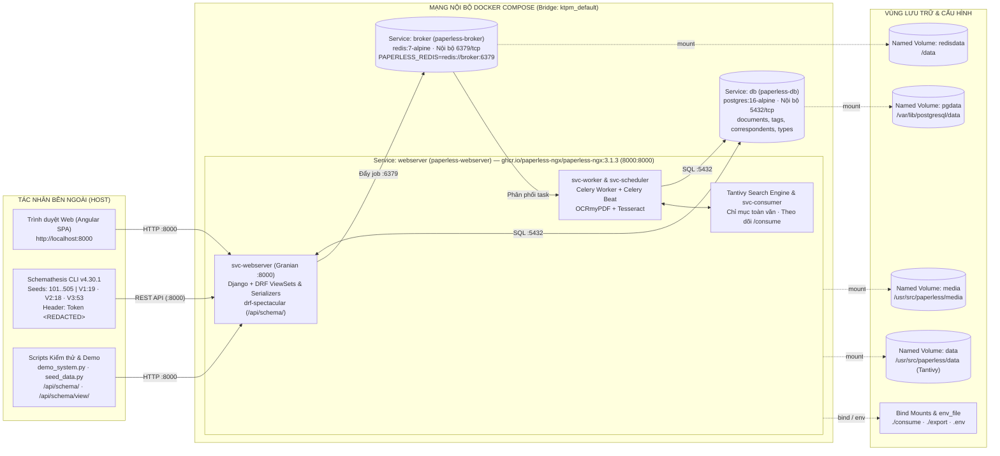
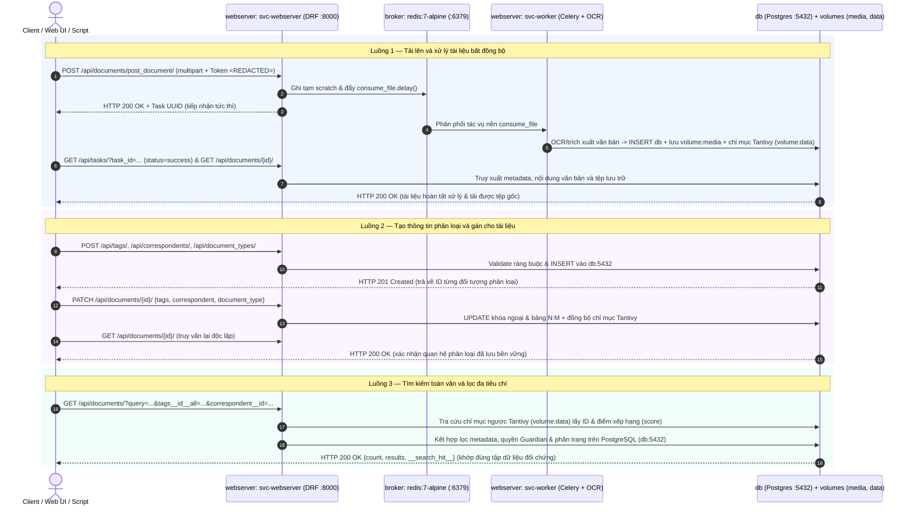

# TỔNG HỢP MÃ NGUỒN MERMAID VÀ TỆP DRAW.IO CHO BỘ SƠ ĐỒ BÁO CÁO (CHƯƠNG 2 & CHƯƠNG 4)
**Đề tài R08 + K05: Kiểm thử API Paperless-ngx v3.1.3 bằng Schemathesis · Nhóm 17**  
*Thành viên thực hiện & đối chiếu cấu hình Compose: TV4 — Nguyễn Nhất Minh (MSSV: 2312690)*

Tài liệu này cung cấp mã nguồn sơ đồ đã đối chiếu 1–1 với [`docker-compose.yml`](../../docker-compose.yml) và kết quả vận hành thực tế:
1. **Sơ đồ kiến trúc triển khai Container (Docker Compose)** — chèn Chương 4.
2. **Sơ đồ luồng dữ liệu 3 nghiệp vụ vận hành trên cấu hình Compose** — chèn Chương 4.
3. **Sơ đồ quan hệ dữ liệu cốt lõi (ER Diagram)** — tham chiếu Chương 2 / Chương 4.

---

## 1. SƠ ĐỒ KIẾN TRÚC TRIỂN KHAI CONTAINER (DOCKER COMPOSE)

- **Ảnh 300 DPI chèn Word:** [`docs/images/so_do_kien_truc_container.png`](../images/so_do_kien_truc_container.png)
- **Ảnh Vector SVG:** [`docs/images/so_do_kien_truc_container.svg`](../images/so_do_kien_truc_container.svg)
- **Tệp chỉnh sửa Draw.io:** [`docs/diagrams/so_do_kien_truc_container.drawio`](so_do_kien_truc_container.drawio)
- **Chú thích gợi ý chèn Word:**  
  *Hình 4.1. Kiến trúc triển khai ba dịch vụ Docker Compose (`webserver`, `db`, `broker`), các tiến trình nội bộ dưới `s6-overlay` và các vùng lưu trữ của Paperless-ngx v3.1.3 trong môi trường thực nghiệm.*

---

## 2. SƠ ĐỒ LUỒNG DỮ LIỆU BA NGHIỆP VỤ VẬN HÀNH TRÊN CẤU HÌNH COMPOSE

- **Ảnh 300 DPI chèn Word:** [`docs/images/so_do_luong_du_lieu.png`](../images/so_do_luong_du_lieu.png)
- **Ảnh Vector SVG:** [`docs/images/so_do_luong_du_lieu.svg`](../images/so_do_luong_du_lieu.svg)
- **Chú thích gợi ý chèn Word:**  
  *Hình 4.2. Luồng dữ liệu của ba nghiệp vụ vận hành trọng tâm (tải lên và xử lý nền, gán thông tin phân loại, tìm kiếm và lọc) ánh xạ trên các dịch vụ Docker Compose và vùng lưu trữ.*

---

## 3. SƠ ĐỒ QUAN HỆ DỮ LIỆU CỐT LÕI (ER DIAGRAM)

- **Ảnh 300 DPI chèn Word:** [`docs/images/so_do_quan_he_du_lieu.png`](../images/so_do_quan_he_du_lieu.png)
- **Ảnh Vector SVG:** [`docs/images/so_do_quan_he_du_lieu.svg`](../images/so_do_quan_he_du_lieu.svg)
- **Tệp chỉnh sửa Draw.io:** [`docs/diagrams/so_do_quan_he_du_lieu.drawio`](so_do_quan_he_du_lieu.drawio)
- **Chú thích gợi ý chèn Word:**  
  *Hình 4.3. Sơ đồ quan hệ dữ liệu giữa thực thể tài liệu (`Document`) và ba nhóm thực thể phân loại (`Tag`, `Correspondent`, `DocumentType`) trong PostgreSQL (`src/documents/models.py`, tag `v3.1.3`).*
