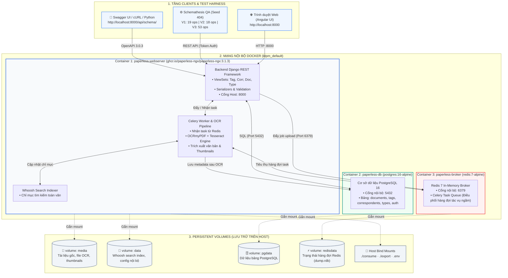
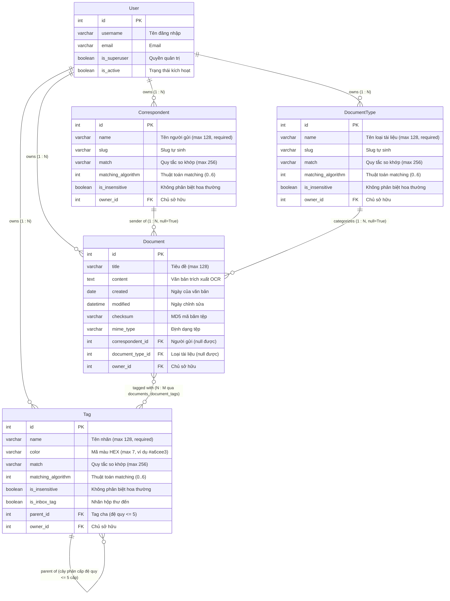

# TỔNG HỢP MÃ NGUỒN MERMAID VÀ DRAW.IO CHO 2 SƠ ĐỒ BÁO CÁO
**Đề tài R08 + K05: Kiểm thử hệ thống Paperless-ngx v3.1.3 · Nhóm 17**  
*Thành viên thực hiện: TV4 — Nguyễn Nhất Minh (MSSV: 2312690)*

Tài liệu này cung cấp đầy đủ:
1. **Mã Mermaid** để hiển thị trực tiếp trên GitHub / Markdown / Notion.
2. **Tệp Draw.io (`.drawio`)** để mở, chỉnh sửa màu sắc, kéo thả và xuất ảnh PNG/PDF trên [app.diagrams.net](https://app.diagrams.net).

---

## 1. HÌNH 1: SƠ ĐỒ KIẾN TRÚC CONTAINER HỆ THỐNG (DOCKER COMPOSE)

### 1.1. Mã nguồn Mermaid (Hình 1)
Sao chép toàn bộ khối mã dưới đây để chèn vào Markdown hoặc công cụ hỗ trợ Mermaid:

### 1.2. Tệp Draw.io tương ứng (Hình 1)
- Tệp tin: [`docs/diagrams/so_do_kien_truc_container.drawio`](file:///d:/Kiem-thu-phan-mem/KTPM/docs/diagrams/so_do_kien_truc_container.drawio)
- Ảnh xuất sẵn 300 DPI: [`docs/images/so_do_kien_truc_container.png`](file:///d:/Kiem-thu-phan-mem/KTPM/docs/images/so_do_kien_truc_container.png)

---

## 2. HÌNH 2: SƠ ĐỒ QUAN HỆ DỮ LIỆU CỐT LÕI (ER DIAGRAM)

### 2.1. Mã nguồn Mermaid (Hình 2)
Sao chép toàn bộ khối mã dưới đây:

### 2.2. Tệp Draw.io tương ứng (Hình 2)
- Tệp tin: [`docs/diagrams/so_do_quan_he_du_lieu.drawio`](file:///d:/Kiem-thu-phan-mem/KTPM/docs/diagrams/so_do_quan_he_du_lieu.drawio)
- Ảnh xuất sẵn 300 DPI: [`docs/images/so_do_quan_he_du_lieu.png`](file:///d:/Kiem-thu-phan-mem/KTPM/docs/images/so_do_quan_he_du_lieu.png)

---

## 3. HƯỚNG DẪN MỞ VÀ CHỈNH SỬA TRÊN DRAW.IO (APP.DIAGRAMS.NET)

### Cách 1: Mở trực tiếp file `.drawio` (Khuyên dùng - Nhanh và đẹp nhất)
1. Truy cập trang web vẽ sơ đồ miễn phí: **https://app.diagrams.net/** (hoặc mở phần mềm draw.io Desktop).
2. Chọn **Open Existing Diagram** (Mở sơ đồ có sẵn) $\rightarrow$ Duyệt tới thư mục `docs/diagrams/` trong dự án:
   * Chọn `so_do_kien_truc_container.drawio` (Hình 1) hoặc `so_do_quan_he_du_lieu.drawio` (Hình 2).
3. Sơ đồ sẽ mở ra với đầy đủ các khối hộp, màu sắc chuyên nghiệp, đường mũi tên động và chữ tiếng Việt chuẩn. Bạn có thể tự do kéo giãn, đổi màu hoặc thay đổi font chữ theo ý muốn.
4. **Xuất file ảnh:** Chọn **File** $\rightarrow$ **Export as** $\rightarrow$ **PNG...** (chọn độ phân giải 300 DPI để chèn vào báo cáo Word hoặc Slide).

### Cách 2: Nhập trực tiếp mã Mermaid vào Draw.io
1. Trên giao diện của draw.io, vào menu trên cùng: **Arrange** $\rightarrow$ **Insert** $\rightarrow$ **Advanced** $\rightarrow$ **Mermaid**.
2. Dán đoạn mã Mermaid ở Mục 1.1 hoặc 2.1 phía trên vào ô nhập liệu.
3. Bấm nút **Insert** $\rightarrow$ Draw.io sẽ tự động dựng toàn bộ sơ đồ thành các đối tượng đồ họa để bạn chỉnh sửa.
